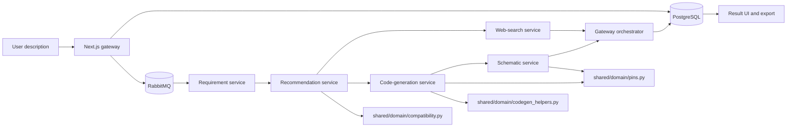

# MCU Project Assistant code graph

Snapshot: GitHub `main` at `38f8c930b492ce3592f04dec7fd051365d21e2e7`, inspected 2026-07-29.

## Machine-readable graph

GitNexus indexed the repository with full-text search, vector search, program-dependence analysis, and local embeddings enabled.

| Metric | Value |
| --- | ---: |
| Indexed source files | 176 |
| Symbols / nodes | 4,739 |
| Relationships / edges | 10,380 |
| Functional clusters | 55 |
| Detected execution flows | 61 |

The local graph lives in `.gitnexus/`. Rebuild it from the repository root with:

```powershell
$env:PATH = 'C:\Program Files\Git\mingw64\bin;' + $env:PATH
$env:HF_ENDPOINT = 'https://hf-mirror.com'
gitnexus analyze --force --pdg --embeddings
```

The PATH addition is needed on this Windows machine so LadybugDB can load the OpenSSL 3 DLLs shipped with Git for Windows. The mirror is only needed when the embedding model is not already cached.

## System graph



## Core execution traces

The graph confirms these high-value call paths:

- Trial pipeline: `main` -> `stage_codegen` -> `assign_pins` -> `sanitize_pin_name`.
- Production code generation: `generate_code` -> `assign_pins` -> `sanitize_pin_name`.
- Schematic generation: `generate_diagram` -> `assign_pins` -> `sanitize_pin_name`.
- Live distributor lookup: `handle_websearch` -> `search_distributor` -> `_search_digikey` -> `wait`.
- Progress streaming: `start` -> `poll` -> `buildPreview` -> `countComponents`.

## Critical graph findings

1. `assign_pins` is shared by trial, code generation, and schematic generation, so it is a high-blast-radius correctness seam. It accepts a platform argument but always clones `PLATFORM_PINS["arduino"]` and hard-codes Arduino I2C, SPI, and UART pins. ESP32 and STM32 therefore cannot be trusted even when upstream schemas say they are supported.
2. `validate_code` is called by production code generation, but only checks for the strings `void setup()`, `void loop()`, and a pin token. It never compiles firmware, resolves libraries, checks board targets, or executes tests.
3. `validateConsistency` only compares two generated pin lists. Since codegen and schematic both depend on the same faulty `assign_pins`, they can agree with each other while both are electrically wrong.
4. `recommend_components` ignores the selected platform when choosing the board: it always injects an Arduino Uno and creates unknown components with Arduino-only compatibility, default price, voltage, and pin count.
5. `aggregate_prices` compares numeric prices from multiple currencies without conversion and labels the result USD. A cheaper CNY number can therefore beat a USD/EUR number and still be reported as USD.

These seams should become explicit modules with executable contracts: platform capability model, component evidence model, firmware compiler adapter, simulator adapter, and electrical-rule validator.
