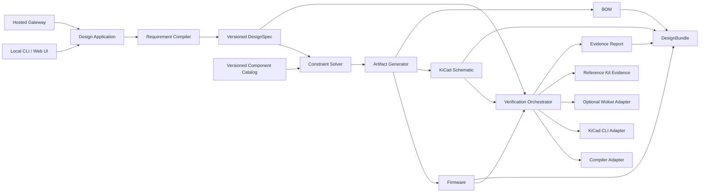

# Verified Maker Bundle v1 Design

## Decision Summary

MCU Project Assistant will become an evidence-first embedded design agent for makers and beginners. The first delivery is deliberately narrow: Arduino UNO, a curated Reference Kit, and 5–8 representative projects. A design is never called ready merely because text was generated; readiness is derived from compiler, electrical-rule, simulation, and hardware evidence attached to the exact DesignSpec revision.

The open-source local product is complete for its supported scope. The future commercial service reuses the same core and adds managed execution, current supplier data, collaboration, fleet capacity, and support through adapters.

## Scope

### Included in v1

- Arduino UNO as the first fully supported Platform.
- A versioned Reference Kit of 10–15 common parts with datasheet provenance, voltage limits, buses, pin capabilities, library dependencies, and purchasable part identities.
- Five to eight golden projects, including smart watering, temperature/humidity display, distance alarm, and servo control.
- Natural-language requirements compiled into a reviewable DesignSpec.
- Deterministic constraint solving for board, voltage, pins, buses, timers, libraries, and part compatibility.
- Arduino CLI or PlatformIO compilation, KiCad schematic generation and ERC, optional Wokwi scenarios, and recorded physical-kit acceptance.
- A downloadable DesignBundle and Evidence Report.
- A local process runner that requires no account, message broker, database, or cloud token.

### Explicitly deferred

- Broad arbitrary-part support, PCB routing, manufacturing files, autonomous purchasing, multi-user collaboration, billing, and fleet deployment.
- STM32 support. ESP32 begins only after the Arduino UNO acceptance gate passes, using the same interfaces and evidence rules.
- Claims that unrestricted natural-language projects can be completed without human review.

## Architecture

The system is organized around deep modules with small interfaces. The canonical seam is one application operation:

```text
buildDesign(request, verificationProfile, executionMode) -> DesignBundle
```

Callers do not coordinate individual generators or validators. The application module owns ordering, revision identity, bounded repair attempts, evidence collection, and the final readiness decision.



### Module responsibilities

- **Requirement Compiler** converts user language into explicit behaviours, thresholds, units, actuators, displays, safety expectations, and unresolved questions. It cannot silently replace OLED with LCD or convert percentages into undocumented raw ADC values.
- **Constraint Solver** is the only authority for board capabilities, power compatibility, bus allocation, pin assignment, timer conflicts, and library compatibility. Generators consume its result and cannot invent pins independently.
- **Component Catalog** is local, versioned, and provenance-aware. Price observations include currency, supplier, region, quantity, timestamp, and source; prices without comparable currency and quantity are not ranked together.
- **Artifact Generator** produces firmware, a real KiCad schematic, BOM, and manifests from one solved DesignSpec. It does not decide readiness.
- **Verification Orchestrator** invokes adapters, captures exact commands, versions, logs, artifacts, and timestamps, then evaluates a Verification Profile. It performs at most three targeted repair attempts and preserves every failed attempt in the report.
- **Execution Adapter** selects an in-process Local Runner or queued Hosted Runner without changing domain semantics. Existing RabbitMQ stages migrate behind the Hosted Runner incrementally.

## Domain Model and Invariants

### Primary records

- `DesignSpec`: immutable revision containing requirements, Platform, board, selected parts, electrical constraints, pin assignments, expected behaviours, and declared assumptions.
- `BoardProfile`: versioned pin, voltage, memory, timer, bus, and toolchain capabilities for one board.
- `ComponentDefinition`: stable part identity, electrical and protocol facts, library bindings, simulation support, and provenance.
- `ArtifactSet`: firmware, schematic, BOM, manifests, and content hashes produced from one DesignSpec revision.
- `VerificationRun`: one adapter execution against one immutable ArtifactSet, including tool identity, status, logs, duration, and produced evidence.
- `EvidenceReport`: all required, passed, failed, unavailable, and not-run checks, plus the derived readiness result.
- `DesignBundle`: the DesignSpec, ArtifactSet, and Evidence Report packaged together.

### Non-negotiable invariants

1. Firmware, schematic, BOM, and evidence reference the same DesignSpec revision and content hashes.
2. Every used signal has one semantic role and a board-valid pin; every powered part has a compatible rail or an explicit level/power adaptation circuit.
3. A requirement may be clarified or rejected, but never silently weakened or substituted.
4. `passed` requires captured tool evidence. Missing tools, credentials, network access, or unsupported models produce `unavailable` or `not-run`, never `passed`.
5. Overall readiness is derived from a named Verification Profile. Individual dimensions remain visible rather than being collapsed into a misleading single validation flag.
6. A price without currency, region, quantity, timestamp, and source is informational only and cannot determine the cheapest option.

## Data Flow and Failure Handling

1. The user describes a project and selects a Verification Profile.
2. Requirement Compiler creates a DesignSpec draft and returns blocking questions when a safety-critical or behaviour-defining fact is missing.
3. Constraint Solver either produces a solved DesignSpec or structured conflicts with suggested remedies.
4. Artifact Generator produces firmware, KiCad schematic, BOM, and manifests from the solved revision.
5. Verification Orchestrator runs required checks locally and optional adapters when configured.
6. A failed check may trigger a bounded repair using structured diagnostics. Each repair creates a new DesignSpec or ArtifactSet revision; evidence is never reassigned across revisions.
7. The application returns a DesignBundle with `ready`, `partial`, or `blocked`, derived from the selected profile.

Failures are user-facing facts, not hidden exceptions. Tool absence includes installation guidance; constraint conflicts name the exact pins, rails, or resources involved; model failures retain the last valid DesignSpec; hosted worker retries are idempotent by revision hash.

## Verification Profiles

### `local-ready`

Requires requirement-fidelity checks, constraint checks, firmware compilation, and KiCad ERC. It works without an account or cloud token. Optional Wokwi evidence is displayed but is not required when the selected parts lack simulation models.

### `simulated`

Requires `local-ready` plus a passing Wokwi scenario that drives inputs and asserts observable outputs. This profile requires configured Wokwi access and supported virtual hardware.

### `reference-kit-verified`

Requires `local-ready`, any applicable simulation scenario, and a signed physical acceptance record for the exact Reference Kit revision, firmware hash, wiring revision, measurements, operator, and date.

## Acceptance Metrics

The Arduino UNO milestone passes only when:

- All golden projects preserve 100% of their critical behavioural requirements in DesignSpec and generated artifacts.
- All golden firmware builds pass from a clean environment with pinned toolchain and library versions.
- All generated golden schematics pass KiCad ERC with zero unwaived errors; every waiver is explicit and justified.
- Every simulatable golden project passes its automated Wokwi scenario; unsupported simulations are labeled unsupported rather than passed.
- Pin, voltage, and bus conflicts are zero across the golden suite.
- At least three representative projects pass the versioned physical Reference Kit procedure on real hardware.
- Repeating the same pinned input produces the same solved DesignSpec and artifact hashes, excluding declared nondeterministic metadata.
- A clean local installation completes the `local-ready` path without Postgres, Redis, RabbitMQ, hosted login, or paid API credentials.
- CI runs tests, lint, production build, Python tests, golden compilation, and ERC; warnings and skipped checks are reported separately from passes.

Baseline numbers recorded on 2026-07-29 are not acceptance: 254 frontend tests passed, 69 CI-targeted Python tests passed, but the full Python suite had 3 failures; lint had 33 warnings; production build emitted runtime warnings; and the trial pipeline reported a false-positive success without compilation, ERC, or simulation.

## Testing Strategy

- **Domain tests** cover Requirement Compiler and Constraint Solver invariants with table-driven and property-style cases.
- **Golden tests** compare requirements, solved DesignSpec, generated artifacts, and evidence for the curated project set.
- **Adapter contract tests** run the same expectations against real and fake compiler, ERC, simulator, catalog, and execution adapters.
- **Integration tests** invoke pinned Arduino CLI/PlatformIO and KiCad CLI in reproducible containers or local tool manifests.
- **Simulation tests** use deterministic Wokwi automation scenarios for sensor input, timing, serial output, and actuator state.
- **Hardware tests** use documented fixtures and record measured outcomes; they are never silently replaced by simulation.
- **End-to-end tests** prove both Local Runner and Hosted Runner produce semantically equivalent bundles for the same pinned inputs.

## Open-source and Commercial Boundary

The domain model, local catalog format, generators, constraint solver, local runner, verification interfaces, evidence schema, CLI, and supported Reference Kit definitions are Apache-2.0 open source. A user can inspect, run, modify, and validate the supported workflow locally.

Commercial modules may provide managed workers, organization permissions, collaboration, retained history, private catalogs, continuously refreshed supplier intelligence, larger simulation capacity, observability, compliance controls, and support. They attach at documented seams and may not redefine a failed check as passed. Exported DesignBundles remain portable and verifiable with the open-source core.

## Delivery Sequence

1. **Trust baseline:** add license and README claims, make CI truthful, pin tools, fix full-suite isolation, and replace fake success labels.
2. **Canonical design core:** introduce DesignSpec revisions, BoardProfile, ComponentDefinition, constraint solving, and evidence schema behind the single application interface.
3. **UNO artifact path:** generate compilable firmware and real KiCad schematics for the curated Reference Kit.
4. **Verification path:** integrate compiler and ERC adapters, then Wokwi scenarios and bounded repair.
5. **Measured release:** execute the golden suite and at least three physical projects, publish the evidence matrix, and only then label v1 ready.
6. **ESP32 parity:** add an ESP32 BoardProfile and Reference Kit delta without changing the core interface.

Each sequence item receives its own implementation plan and reviewable commit series. This document specifies the first product slice and its gates; it does not authorize broad platform expansion before Arduino UNO passes.
